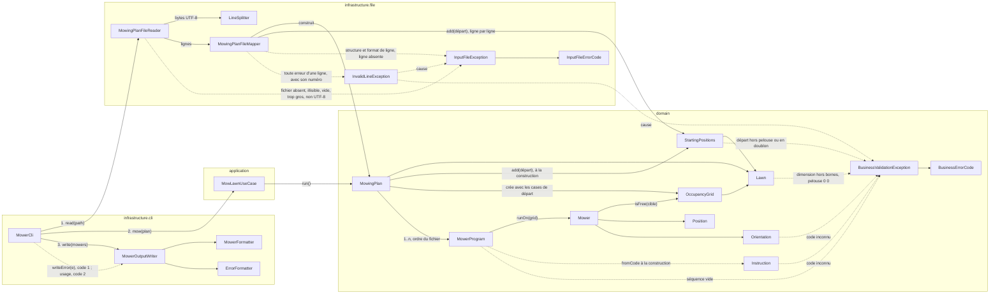

# Architecture du code

Vue du code livré, à mettre à jour dans la PR de chaque US qui ajoute ou déplace une classe. La conception cible et ses arbitrages sont dans [`plans/tondeuse.tech.md`](plans/tondeuse.tech.md).

## Couches

Hexagonal à 3 couches (§ 1 de `conventions/java.md`) :

- **`domain`** : modèle immuable et règles métier. Pur, sans I/O ni framework, ce que vérifie `DomainPurityTest` (ArchUnit).
- **`application`** : `MowLawnUseCase` reçoit un `MowingPlan` déjà construit et renvoie les tondeuses finales. La couche ne dépend d'aucun adapter, ce que vérifie `ArchitectureTest` (ArchUnit) : chaque point d'entrée (CLI aujourd'hui, API demain) produit le plan dans son format et rend le résultat dans le sien.
- **`infrastructure`** : adapters concrets, sans interface tant qu'il n'existe qu'une implémentation. `file` lit et analyse le fichier d'entrée, `cli` porte le point d'entrée, appelle le cas d'usage et rend son résultat sur stdout. `file` lit et analyse le fichier d'entrée, `cli` porte le point d'entrée et le rendu sur stdout.

## Vue des classes

## Flux d'exécution

1. `MowerCli` vérifie qu'il a reçu exactement un argument (sinon `ERROR: usage: mower <file>`, code `2`, sans lecture de l'entrée standard), puis demande le plan à `MowingPlanFileReader` avec le chemin du fichier. Un chemin invalide pour le système de fichiers (caractère NUL) est signalé comme fichier absent, code `1`.
2. `MowingPlanFileReader` fait les contrôles sur le fichier entier, sans numéro de ligne, chacun bloquant le suivant : chemin absent, dossier ou illisible → taille annoncée par `Files.size` (> 10 000 000 octets : rejet avant toute lecture du contenu) → lecture plafonnée à 10 000 001 octets (`readNBytes`, qui borne la mémoire même si la taille annoncée était fausse : fichier qui grossit, pipe nommé) → fichier vide → décodage UTF-8 strict (`CharsetDecoder` en mode `REPORT`). Une `IOException` est traduite en `InputFileException` « fichier illisible ». Ensuite, `LineSplitter` découpe les lignes sur `\n` (un `\r` qui précède est retiré, un `\r` isolé reste dans la ligne ; un unique saut de ligne final ne produit pas de ligne vide, un second en produit une).
3. `MowingPlanFileMapper` traduit les lignes en `MowingPlan` : la pelouse, puis un `MowerProgram` par couple de lignes (position, instructions), dans l'ordre du fichier. C'est le seul endroit qui connaît le format texte. Avant d'analyser une ligne, il en vérifie la structure : un BOM (U+FEFF) en tête de la ligne 1, une ligne vide ou un `\r` restant sont rejetés sur cette ligne. Une ligne d'instructions vide est donc signalée comme ligne vide (RM-21) : le refus d'une séquence vide par `MowerProgram` (RM-20) reste un invariant du domaine. Les lignes de pelouse et de position sont reconnues par une regex ancrée (valeurs séparées par une seule espace U+0020, coordonnées `0|[1-9][0-9]{0,8}` en chiffres ASCII, vérifiées avant toute conversion en `int`) ; l'orientation et la ligne d'instructions sont validées par le domaine (`Orientation.fromCode`, `MowerProgram`). Le constructeur de `Lawn` borne chaque dimension à `0..40075016` et refuse la pelouse `0 0`. Chaque position de départ est confiée, au moment où sa ligne est analysée, à `StartingPositions` (un `HashSet<Position>`, O(1) moyen par tondeuse), qui la rejette si elle est hors pelouse ou déjà prise : l'erreur garde ainsi le numéro de sa ligne et l'ordre des lignes. Le constructeur de `MowingPlan` applique aussi ces deux règles, via `StartingPositions` : le plan est valide quel que soit l'adapter qui le construit. Pour un fichier, la règle s'exécute donc deux fois, mais le contrôle du mapper échoue toujours le premier : RM-23 impose de signaler la première erreur dans l'ordre des lignes, ce qu'une validation globale du plan ne permettrait pas. Les constructeurs et les `fromCode` du domaine portent la validation fonctionnelle : le plan obtenu est entièrement valide. L'analyse fait un seul passage dans l'ordre des lignes et s'arrête à la première erreur. Les erreurs de format (`InputFileException`, codes `InputFileErrorCode`) et les erreurs métier du domaine (`BusinessValidationException`, codes `BusinessErrorCode`, qui ignorent tout du fichier) levées pendant l'analyse d'une ligne sont enveloppées dans une `InvalidLineException`, qui porte le numéro de la ligne et garde l'erreur d'origine comme cause. Une ligne attendue mais absente (tondeuse, instructions) est signalée avec le numéro de la ligne attendue.
4. `MowerCli` passe le plan à `MowLawnUseCase.mow`, qui délègue à `MowingPlan.run()`. `run()` crée une `OccupancyGrid` (grille creuse : un `HashSet<Position>`, la pelouse n'est jamais matérialisée ; `Position` redéfinit son hash, car celui d'un record, `31 * x + y`, fait collisionner les cases d'une grille dense de 10⁶ tondeuses) avec toutes les cases de départ, puis exécute les tondeuses l'une après l'autre : la suivante ne bouge qu'une fois la précédente arrêtée. Au démarrage, une tondeuse libère sa case de départ ; à l'arrêt, elle occupe sa case finale. Un `F` vers une case hors pelouse ou occupée est ignoré ; la simulation ne lève aucune erreur.
5. `MowerCli` passe la liste des tondeuses finales à `MowerOutputWriter`, qui écrit `X Y O\n` en UTF-8 pour chaque tondeuse, dans l'ordre du fichier, dans un writer bufferisé que `MowerCli` vide une seule fois en fin d'exécution (succès comme erreur), puis `MowerCli` rend le code de sortie `0`.

En cas d'erreur, `MowerCli` est le seul à traduire l'exception en texte : `ErrorFormatter` produit `ERROR line <n>: <description>` pour une `InvalidLineException`, ou `ERROR: <description>` pour une `InputFileException` sur le fichier entier, en échappant les caractères invisibles cités (`\\`, `\t`, `\r`, `\n`, `\uXXXX` pour les autres caractères de contrôle, de format et séparateurs de ligne) pour que le message tienne sur une ligne lisible, écrit par `MowerOutputWriter`, et le code de sortie est `1`. Comme le plan est validé en entier avant la simulation, aucune position finale n'a été écrite.

Volumétrie (US-007) : un fichier de près de 10 Mo, avec une tondeuse et ~10⁷ instructions ou de l'ordre de 10⁶ tondeuses (~7.10⁵ dans le test, proche du maximum que permettent 10 Mo), est traité de l'ordre de la seconde avec la heap par défaut ; `MowerCliLoadIntegrationTest` le vérifie sur des fichiers générés, et il est exclu des tests lancés par PIT (pas des classes mutées : `targetClasses` et le seuil de 100 % sont inchangés), car il ne tue aucun mutant de plus.

Une nouvelle source d'entrée (API, Kafka) apporterait son propre adapter et son mapper vers le même `MowingPlan`, et rendrait elle-même la liste renvoyée par `MowLawnUseCase.mow`, sans toucher au domaine ni au cas d'usage. Elle bénéficierait des invariants portés par les constructeurs du domaine (pelouse, départs, orientations, instructions) ; seules les règles propres au format restent à écrire dans son mapper.
