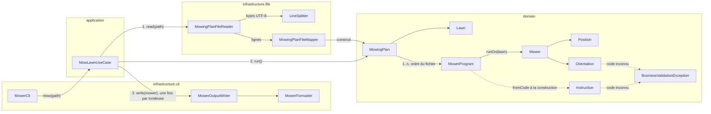

# Architecture du code

Vue du code livré, à mettre à jour dans la PR de chaque US qui ajoute ou déplace une classe. La conception cible et ses arbitrages sont dans [`plans/tondeuse.tech.md`](plans/tondeuse.tech.md).

## Couches

Hexagonal à 3 couches (§ 1 de `conventions/java.md`) :

- **`domain`** : modèle immuable et règles métier. Pur, sans I/O ni framework, ce que vérifie `DomainPurityTest` (ArchUnit).
- **`application`** : `MowLawnUseCase` enchaîne lecture, simulation et rendu.
- **`infrastructure`** : adapters concrets, sans interface tant qu'il n'existe qu'une implémentation. `file` lit et analyse le fichier d'entrée, `cli` porte le point d'entrée et le rendu sur stdout.

## Vue des classes

## Flux d'exécution

1. `MowerCli` reçoit le chemin du fichier et appelle `MowLawnUseCase.mow`.
2. `MowingPlanFileReader` lit les octets, les décode en UTF-8, et `LineSplitter` découpe les lignes sur `\n` (un `\r` qui précède est retiré).
3. `MowingPlanFileMapper` traduit les lignes en `MowingPlan` : la pelouse, puis un `MowerProgram` par couple de lignes (position, instructions), dans l'ordre du fichier. C'est le seul endroit qui connaît le format texte. Les constructeurs et les `fromCode` du domaine portent la validation fonctionnelle : le plan obtenu est entièrement valide.
4. `MowingPlan.run()` exécute les tondeuses l'une après l'autre : la suivante ne bouge qu'une fois la précédente arrêtée. Un `F` qui ferait sortir de la pelouse est ignoré ; la simulation ne lève aucune erreur.
5. `MowerOutputWriter` écrit `X Y O\n` en UTF-8 sur stdout pour chaque tondeuse, dans l'ordre du fichier, et `MowerCli` rend le code de sortie `0`.

Une nouvelle source d'entrée (API, Kafka) apporterait son propre adapter et son mapper vers le même `MowingPlan`, sans toucher au domaine ni au cas d'usage.
