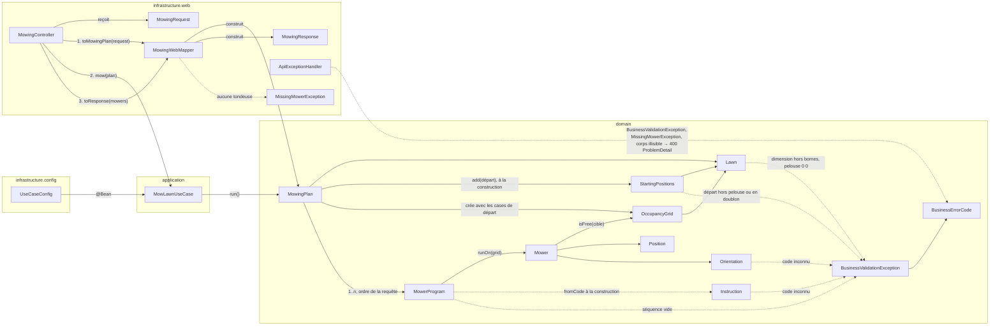

# Architecture du code

Vue du code livré, à mettre à jour dans la PR de chaque US qui ajoute ou déplace une classe. La conception initiale et ses arbitrages sont dans [`plans/tondeuse.tech.md`](plans/tondeuse.tech.md). Cette conception décrit une CLI lisant un fichier texte : depuis, la CLI a été remplacée par une API HTTP JSON.

## Couches

Hexagonal à 3 couches (§ 1 de `conventions/java.md`) :

- **`domain`** : modèle immuable et règles métier. Pur, sans I/O ni framework, ce que vérifie `DomainPurityTest` (ArchUnit).
- **`application`** : `MowLawnUseCase` reçoit un `MowingPlan` déjà construit et renvoie les tondeuses finales. La couche ne dépend d'aucun adapter, ce que vérifie `ArchitectureTest` (ArchUnit), ni de Spring : le cas d'usage est déclaré comme bean dans `infrastructure.config.UseCaseConfig`.
- **`infrastructure`** : tout ce qui touche à Spring. `MowerApplication` démarre l'application, `config` déclare les beans des couches internes, `web` porte l'API REST : contrôleur, DTO (records, avec leurs sous-objets en records imbriqués), mapper et traduction des erreurs en `ProblemDetail`. Le passage à l'API n'a modifié aucun fichier hors de `infrastructure`.

## API

`POST /mowings`, corps `application/json` :

```json
{
  "lawn": {"maxX": 5, "maxY": 5},
  "mowers": [
    {"x": 1, "y": 2, "orientation": "N", "instructions": "LFLFLFLFF"},
    {"x": 3, "y": 3, "orientation": "E", "instructions": "FFRFFRFRRF"}
  ]
}
```

Réponse `200`, une entrée par tondeuse dans l'ordre de la requête, dans l'enveloppe `items` (§ 3, réponses de type liste) :

```json
{"items": [{"x": 1, "y": 3, "orientation": "N"}, {"x": 5, "y": 1, "orientation": "E"}]}
```

Erreur : `400`, `application/problem+json` (RFC 7807) avec le membre d'extension `code` (nom stable de `BusinessErrorCode`, `MALFORMED_REQUEST` pour un corps illisible ou `MISSING_MOWER` pour une liste de tondeuses vide), par exemple `{"status": 400, "title": "Invalid orientation", "detail": "invalid orientation 'X'", "code": "INVALID_ORIENTATION", "instance": "/mowings"}`.

## Vue des classes



## Flux d'exécution

1. Jackson désérialise le corps en `MowingRequest` (records imbriqués `MowingRequest.Lawn`, `MowingRequest.Mower`). Un champ absent ou `null`, une valeur mal typée ou un élément `null` dans `mowers` sont refusés à cette étape (`application.yaml` : `fail-on-missing-creator-properties`, `fail-on-null-creator-properties`, `fail-on-null-for-primitives` ; `@JsonSetter(contentNulls = FAIL)` sur `mowers`) : `ApiExceptionHandler` traduit l'`HttpMessageNotReadableException` en `400` avec le code `MALFORMED_REQUEST`, sans exposer le message Jackson. Ce code est propre au format de la requête : il est défini dans `ApiExceptionHandler`, pas dans `BusinessErrorCode`.
2. `MowingWebMapper.toMowingPlan` construit la `Lawn`, refuse une liste de tondeuses vide (`MissingMowerException`, code `MISSING_MOWER` défini comme `MALFORMED_REQUEST` dans `ApiExceptionHandler`), puis un `MowerProgram` par tondeuse, dans l'ordre de la requête. Il ne porte aucune autre règle : les constructeurs et les `fromCode` du domaine valident les dimensions de la pelouse (`0..40075016`, pas de `0 0`), l'orientation (`N`, `E`, `S`, `W`) et les instructions (`L`, `R`, `F`, séquence non vide). Le constructeur de `MowingPlan` vérifie enfin, via `StartingPositions`, qu'aucun départ n'est hors pelouse ni en doublon. Le plan obtenu est entièrement valide ; la première règle violée lève une `BusinessValidationException`.
3. `MowingController` passe le plan à `MowLawnUseCase.mow`, qui délègue à `MowingPlan.run()`. `run()` crée une `OccupancyGrid` (grille creuse : un `HashSet<Position>`, la pelouse n'est jamais matérialisée ; `Position` redéfinit son hash, car celui d'un record, `31 * x + y`, fait collisionner les cases d'une grille dense) avec toutes les cases de départ, puis exécute les tondeuses l'une après l'autre : la suivante ne bouge qu'une fois la précédente arrêtée. Au démarrage, une tondeuse libère sa case de départ ; à l'arrêt, elle occupe sa case finale. Un `F` vers une case hors pelouse ou occupée est ignoré ; la simulation ne lève aucune erreur.
4. `MowingWebMapper.toResponse` traduit les tondeuses finales en `MowingResponse` (`items` de `MowingResponse.Mower`, orientation restituée par son code), renvoyée en `200`.

En cas d'erreur métier, `ApiExceptionHandler` (`@RestControllerAdvice`) est le seul à connaître la traduction exception → HTTP : `400`, `title` = titre du `BusinessErrorCode`, `detail` = message de l'exception (en anglais), `code` = nom du `BusinessErrorCode`. Comme le plan est validé en entier avant la simulation, aucune tondeuse n'a bougé.

Ordre des erreurs : la pelouse est validée en premier, puis chaque tondeuse (orientation, instructions) dans l'ordre de la requête, puis les départs de toutes les tondeuses. Un départ en doublon sur la tondeuse 1 et une instruction invalide sur la tondeuse 3 remontent donc l'instruction invalide.

Volumétrie : la taille du corps n'est pas bornée par l'application (la limite de 10 Mo de l'ancien fichier d'entrée n'a pas d'équivalent ici).
