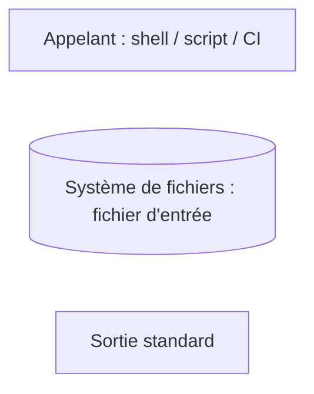
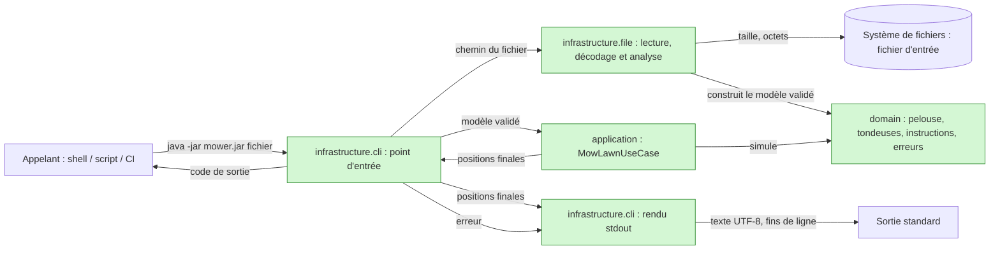

## Vue d'ensemble

La feature est livrée sous forme d'une **CLI Java 25 autonome** (jar exécutable, Maven), sans framework applicatif, organisée en **hexagonal épuré à 3 couches** (`domain` / `application` / `infrastructure`) conformément au référentiel `conventions/java.md` de l'équipe. Le traitement est un pipeline en **deux phases strictes** : le fichier est entièrement lu, décodé et validé en un modèle immuable (pelouse + tondeuses) ; la simulation ne s'exécute que sur ce modèle valide et ne peut plus échouer. Ce découpage découle directement de RM-13 (rejet total, aucun résultat partiel) et de RM-25 (toutes les positions de départ doivent être connues avant de bouger la première tondeuse). L'occupation de la pelouse est une **grille creuse** (ensemble des cases occupées), seule représentation compatible avec les bornes de RM-24.

## Architecture

Le repo est greenfield : l'« avant » se réduit aux composants externes auxquels la CLI se raccorde — l'appelant (shell, script, CI), le système de fichiers qui porte le fichier d'entrée et la sortie standard.

**Avant**

**Après**

**Delta** : un seul nouvel exécutable apparaît, découpé en trois couches.

- **`domain`** (pur : ni I/O, ni framework) porte le modèle — pelouse, position, orientation, instruction, tondeuse —, la grille d'occupation, la simulation (RM-05 à RM-10, RM-15, RM-25), la validation fonctionnelle des valeurs (invariants des value objects, `Orientation.fromCode`, `Instruction.fromCode` : RM-04, RM-14 à RM-19, RM-24 à RM-26) et le catalogue des erreurs métier, sans les erreurs de fichier ni de format. Il ne connaît ni la notion de ligne ni le format du fichier. Sa pureté est garantie par un test ArchUnit (`DomainPurityTest`).
- **`application`** porte un cas d'usage unique, `MowLawnUseCase` : il reçoit le modèle validé (`MowingPlan`), déclenche la simulation et renvoie les positions finales, dans l'ordre du fichier. Il ne dépend d'aucun adapter : chaque point d'entrée (la CLI, une future API) construit le modèle depuis son format et rend le résultat dans le sien. Un test ArchUnit (`ArchitectureTest`) interdit toute dépendance `application → infrastructure`.
- **`infrastructure`** porte tout ce qui touche au monde extérieur : lecture du fichier (existence, dossier, droits, taille RM-27, décodage UTF-8 RM-30, découpage des lignes RM-21), analyse syntaxique ligne à ligne vers le modèle du domaine (RM-20 à RM-22, RM-28, RM-29, RM-31), point d'entrée CLI (arguments, code de sortie), rendu sur stdout (RM-11, RM-32).

Flux : point d'entrée → lecture et analyse (erreurs « fichier entier » puis erreurs « ligne ») → cas d'usage → simulation par le domaine → rendu par le point d'entrée. Le point d'entrée se limite aux arguments, au câblage des dépendances, à l'enchaînement lecture → cas d'usage → rendu et au code de sortie. Toute erreur, quelle que soit la couche qui la lève, remonte au point d'entrée qui la rend au format RM-32. Il n'y a ni appel réseau, ni persistance, ni concurrence.

## Choix techniques

### Stack : Java 25 LTS + Maven, sans framework applicatif

Jar exécutable (`Main-Class` dans le manifeste, dépendances embarquées si nécessaire). Librairies utilitaires autorisées, notamment Apache Commons Lang (`StringUtils`) et Collections (`CollectionUtils`) pour les tests de vide/blanc imposés par la convention de l'équipe.

- *Écartée — Spring Boot* (arbitrage utilisateur) : un conteneur IoC et son temps de démarrage sont surdimensionnés pour une CLI qui lit un fichier et écrit sur stdout ; l'injection par constructeur se fait à la main dans le point d'entrée.
- *Écartées — Kotlin, Python* (arbitrage utilisateur).

### Architecture hexagonale épurée à 3 couches

Application du § 1 « Architecture hexagonale (DDD) » de `conventions/java.md` : `domain/`, `application/`, `infrastructure/`, rôle DDD porté par la place dans l'arborescence, pas d'interface à implémentation unique (la lecture de fichier, le rendu stdout et le cas d'usage sont des classes concrètes), domaine pur vérifié par ArchUnit. La dépendance `application → infrastructure`, que la convention tolère, n'existe pas ici : le cas d'usage reçoit le modèle et renvoie le résultat, ce qui le rend réutilisable tel quel par une future API (arbitrage utilisateur), et `ArchitectureTest` le garantit.

- *Écartée — ports de sortie dans `application` (source du plan, destination du résultat) implémentés par `infrastructure`* : ils inverseraient la dépendance, mais une API appelée en HTTP devrait envelopper le corps de la requête dans une source et accumuler le résultat dans une destination pour le renvoyer. Ces ports ne se justifient que si l'application va elle-même chercher ou publier (job planifié, service distant).

- *Écartée — architecture en couches classique* (arbitrage utilisateur) : ses couches (`controllers/`, `repository/`, `clients/`) sont pensées pour un microservice REST + JPA, absents ici ; l'hexagonal isole en revanche la simulation — le cœur évalué du test — de toute I/O, ce qui la rend testable sans fichier.

Les règles non spécifiques au namespace Pricing Manager s'appliquent (code, tests, langue) ; celles qui lui sont propres (package `com.cdiscount.pricing`, branches `FTPRIC-XXXXX`, Liquibase, Spring/JPA/Kafka/REST) ne s'appliquent pas (arbitrage utilisateur).

### Deux phases strictes : validation complète, puis simulation

Le modèle validé (pelouse + liste ordonnée de tondeuses avec leurs séquences) est construit en entier avant le premier déplacement ; la simulation ne lève aucune erreur.

- *Écartée — traitement en flux* (lire une tondeuse, l'exécuter, mettre sa sortie en tampon, tout jeter à la première erreur) : RM-25 exige de connaître toutes les positions de départ avant de bouger la tondeuse 1, donc le fichier doit être lu en entier de toute façon ; le flux n'économise rien et mêle validation et exécution.

### Lecture du fichier : octets bruts, décodage UTF-8 strict, découpage des lignes maison

Ordre des contrôles « fichier entier », chacun bloquant le suivant : chemin absent, dossier ou illisible (RM-20) → taille via `Files.size` **avant** toute lecture (RM-27) → lecture des octets **plafonnée** à 10 000 001 octets (`InputStream.readNBytes`), avec rejet RM-27 si plus de 10 000 000 octets sont lus → décodage par un `CharsetDecoder` UTF-8 en mode `REPORT` (RM-30). Un BOM est décodé en U+FEFF et laissé à l'analyse, qui le rejette comme erreur de format en ligne 1. Le texte est ensuite découpé sur `\n`, un `\r` immédiatement avant étant retiré (RM-21) ; un `\r` isolé reste dans la ligne et y est rejeté comme caractère invalide ; un unique saut de ligne final ne produit pas de ligne vide, tout saut supplémentaire en produit une (rejetée). Les erreurs « fichier entier » priment donc sur toute erreur de ligne.

`Files.size` ne lit que les métadonnées : il rejette tôt un fichier trop gros sans le charger, mais il ne suffit pas à borner la mémoire. Un fichier peut grossir entre le contrôle et la lecture, et un fichier spécial (pipe nommé, `/proc/...`) peut annoncer une taille de 0 alors qu'il contient plus de données. Le plafond de lecture garantit la borne dans tous les cas. Dans ces deux situations, la taille réelle n'est pas connue : le message ne donne alors que la limite.

- *Écartée — `Files.readAllBytes`* : il charge le fichier en entier, quelle que soit la taille annoncée par `Files.size`.
- *Écartée — `BufferedReader.readLine` / `Files.readAllLines`* : ils acceptent un `\r` seul comme fin de ligne et ne distinguent pas un saut de ligne final unique d'une ligne vide, ce qui rend RM-21 inapplicable.

### Analyse stricte par expressions régulières ancrées

Chaque type de ligne est reconnu par une regex ancrée en ASCII explicite : coordonnée `0|[1-9][0-9]*`, séparateur U+0020 unique, orientation `[NESW]`, instructions `[LRF]+`. Le nombre de valeurs (RM-31), le séparateur (RM-29) et l'écriture des coordonnées (RM-28) sont ainsi vérifiés d'un seul geste. La longueur d'une coordonnée est bornée avant conversion (40 075 016 tient sur 8 chiffres et dans un `int`), ce qui écarte tout dépassement d'entier. La conversion code → enum (`Orientation.fromCode`, `Instruction.fromCode`) est l'unique point de validation de ces valeurs fermées.

L'analyse vit dans `infrastructure.file` (mapper statique `MowingPlanFileMapper`) : elle traduit le format texte en objets du domaine, dont les constructeurs et les `fromCode` portent la validation fonctionnelle. Une erreur levée pendant le mapping d'une ligne, de format ou métier, est enveloppée dans une `InvalidLineException` qui porte le numéro de cette ligne (RM-32). Une future source (API, Kafka) aurait son propre mapper vers le même modèle, sans toucher au domaine ni au cas d'usage.

- *Écartée — analyse dans le domaine* : le domaine connaîtrait le format d'un fichier (lignes, séparateur, position des valeurs), inutilisable pour une autre source.
- *Écartée — DTO intermédiaire commun aux sources* : chaque source a son propre format ; le point commun est le modèle du domaine. Pas d'interface de lecture tant qu'il n'existe qu'une source (§ 1 de `conventions/java.md`).

- *Écartée — `Integer.parseInt` / `Scanner`* : ils acceptent `+3`, `-0`, `05` et les chiffres non ASCII (`٥`), en violation de RM-28, et lèvent une exception technique sur dépassement.

### Erreurs : catalogue de codes et exception métier, arrêt à la première

Inspiré du § 3 « Validation » de `conventions/java.md`, adapté à une CLI, avec deux catalogues au lieu d'un : dans le domaine, un enum `BusinessErrorCode` (un code stable par règle métier : dimension de pelouse, départ hors pelouse ou en doublon, orientation ou instruction invalide, séquence vide) et une `BusinessValidationException` portant ce code et une description en anglais ; dans `infrastructure.file`, un enum `InputFileErrorCode` (fichier absent, illisible, vide, trop gros, encodage invalide, ligne vide ou mal formée, coordonnée invalide, ligne manquante…) et une `InputFileException`. Le numéro de ligne, notion propre au fichier, n'appartient à aucune des deux : une `InvalidLineException` l'ajoute à l'erreur d'une ligne, quelle que soit sa famille ; les erreurs fichier entier de RM-23 n'en ont pas. Jamais d'`IllegalArgumentException` pour une règle métier. L'analyse est un **passage unique dans l'ordre des lignes**, fail-fast : la première erreur rencontrée est celle exigée par RM-23. Le point d'entrée est le seul à traduire l'exception en texte RM-32 et en code de sortie.

- *Écartée — accumulation des erreurs* (type `Result`/`Validation`) : RM-23 ne demande que la première ; accumuler ajoute de la complexité sans consommateur.
- *Écartée — catalogue unique dans `domain/exception/`*, comme le prévoit la convention (arbitrage utilisateur) : le domaine y déclarerait des erreurs de fichier et de format (encodage, BOM, ligne vide…) et un numéro de ligne, alors qu'il ne connaît pas le format du fichier ; une autre source (API) n'en aurait que faire.

### Occupation de la pelouse : grille creuse

Un `HashSet<Position>` initialisé avec toutes les positions de départ (RM-25) ; au démarrage d'une tondeuse sa case est retirée, à son arrêt sa case finale est ajoutée (RM-15). La pelouse n'est représentée que par ses bornes. Une case est bloquante si elle est hors bornes ou dans l'ensemble (RM-08).

- *Écartée — matrice `boolean[][]`* : 40 075 017² cases (RM-24), impossible en mémoire.
- *Écartée — parcours de la liste des tondeuses à chaque `F`* : coût O(n) par pas, alors qu'un fichier de 10 Mo peut décrire de l'ordre de 10⁶ tondeuses.

### Modèle du domaine immuable

Value objects en `record` immuables qui valident leurs invariants dans leur constructeur compact (`Lawn`, `Position`, `Mower`), enums `Orientation` (rotation gauche/droite, déplacement unitaire) et `Instruction`. Les déplacements renvoient une nouvelle instance. La séquence d'instructions est conservée sous forme de `String`, validée caractère par caractère (`Instruction.fromCode`) dans le constructeur compact de `MowerProgram`, puis parcourue caractère par caractère, pas en `List<Instruction>` : la simulation ne travaille que sur une séquence déjà validée et ne peut plus échouer à mi-parcours. Les rotations d'`Orientation` sont des `switch` explicites, indépendants de l'ordre de déclaration des constantes.

- *Écartée — tondeuse mutable* : défendable pour la performance, mais l'allocation de petits records est quasi gratuite sur la JVM, et l'immuabilité simplifie les tests par règle.
- *Écartée — `List<Instruction>`* : jusqu'à 10⁷ références (40 à 80 Mo) pour une information déjà portée par la chaîne validée.

### Sortie standard

Écriture via un writer UTF-8 explicite sur stdout, avec `\n` littéral en fin de chaque ligne, y compris la dernière (RM-11, RM-32), vidé en fin d'exécution. Les caractères de contrôle cités dans un message d'erreur (tabulation, `\r`, U+FEFF…) sont échappés pour garder le message sur une seule ligne lisible.

- *Écartée — `System.out.println`* : utilise le séparateur de la plateforme (`\r\n` sous Windows) et l'encodage de la console, en violation de RM-11.

### Contrat de la CLI (hors spec)

`java -jar mower.jar <fichier>`. Code de sortie : `0` en succès, `1` pour toute erreur `ERROR` de la spec ; zéro ou plusieurs arguments → `ERROR: usage: mower <file>` sur stdout et code `2`. Pas de lecture sur l'entrée standard.

- *Écartée — code de sortie toujours à 0* : colle à la lettre de la spec, qui ne parle que de la sortie, mais empêche un script ou une CI de détecter un échec sans analyser le texte (arbitrage utilisateur).

### Tests

JUnit 6 + AssertJ, conformément au § 9 de `conventions/java.md` (pas de Mockito : aucune classe testée n'a de collaborateur à simuler) :

- **tests unitaires** `*Test`, nommés `shouldX_whenY`, sur le domaine (rotations, déplacements, blocages, grille, validation par règle), sur le découpage des lignes et sur l'analyse du fichier, paramétrés par cas ;
- **tests d'intégration** `*IntegrationTest`, nommés `action_contexte_resultat` avec javadoc de scénario en français, qui lancent le vrai point d'entrée sur des fichiers et comparent stdout et le code de sortie. Fixtures lisibles dans `src/test/resources` ; les cas en octets (BOM, `\r` isolé, UTF-8 invalide, fichier de 10 000 001 octets) sont générés par les tests et non commités. Chaque RM a au moins un cas qui la cite ; RM-12 est le test d'acceptation principal ;
- **`DomainPurityTest`** (ArchUnit) : `domain` ne dépend que de lui-même, de `java.lang` et de `java.util` : ni `java.io`, ni `java.nio.file`, ni aucune librairie ;
- **`ArchitectureTest`** (ArchUnit) : `application` ne dépend pas de `infrastructure` ;
- **mutation testing PIT** sur `com.automower.domain`, lancé par `mvn verify` avec un seuil de 100 % de mutants tués : un mutant survivant fait échouer le build et se corrige en renforçant les tests, jamais en réduisant le périmètre.

- *Écartée — Cucumber/Gherkin* : lisible côté fonctionnel, mais une couche d'outillage complète pour un développeur seul, quand des tests paramétrés nommés par règle donnent la même traçabilité.

### Conventions de code reprises

Issues de `conventions/java.md` § 2 : pas de javadoc ni de commentaire de classe, commentaires rares et en français, identifiants en anglais, messages d'erreur en anglais (cohérent avec RM-32), lignes ≤ 180 caractères, signatures à plus de 3 paramètres un par ligne, streams à plusieurs opérations une étape par ligne, aucun nom de classe pleinement qualifié, classes utilitaires et parseurs `final` à méthodes `static` avec constructeur privé `// vide`, injection par constructeur.

## Performance et scalabilité

Le volume est borné par RM-27 : 10 Mo de fichier, soit au pire ~10⁷ instructions ou ~10⁶ tondeuses. Le fichier est chargé en mémoire en entier (octets puis texte : quelques dizaines de Mo au plus), ce qui est acceptable avec la heap par défaut et simplifie la validation complète exigée par RM-13. La simulation est linéaire dans le nombre total d'instructions (vérification d'occupation en O(1) moyen), et la pelouse n'est jamais matérialisée. Un test d'intégration sur un fichier proche de la limite vérifie que le traitement reste de l'ordre de la seconde.

## Dépendances

Aucune équipe, aucun service, aucun contrat d'interface externe : la feature est autonome. La carte système (`docs/architecture/system.md`) n'est pas fournie ; la spec ne mentionne aucun consommateur.

Dépendances de build et d'exécution, toutes disponibles sur Maven Central :

| Dépendance | Portée | Usage |
|---|---|---|
| JDK 25 LTS, Maven 3.10 | build | compilation, packaging du jar exécutable |
| Apache Commons Lang 3, Commons Collections 4 | runtime | tests de vide/blanc imposés par la convention |
| JUnit 6, AssertJ | test | tests unitaires et d'intégration |
| ArchUnit | test | `DomainPurityTest`, `ArchitectureTest` |
| PIT (pitest-maven + pitest-junit5-plugin) | build | mutation testing du domaine, seuil 100 % dans `verify` |

Référentiel consommé : `conventions/java.md` du plugin `pricing-agent` (règles de code, de validation et de tests ; règles propres au namespace Pricing Manager exclues).
